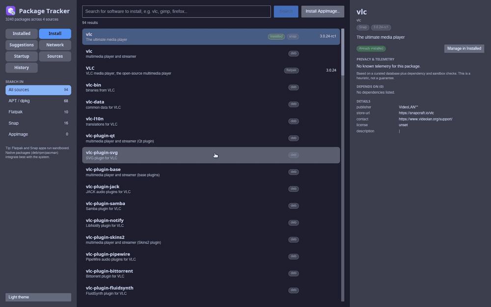
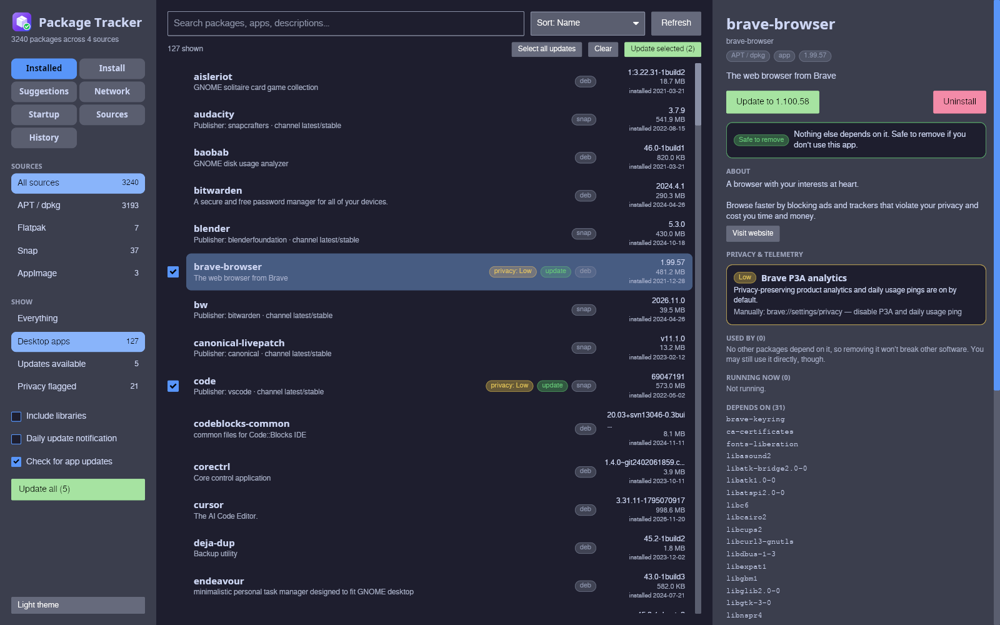
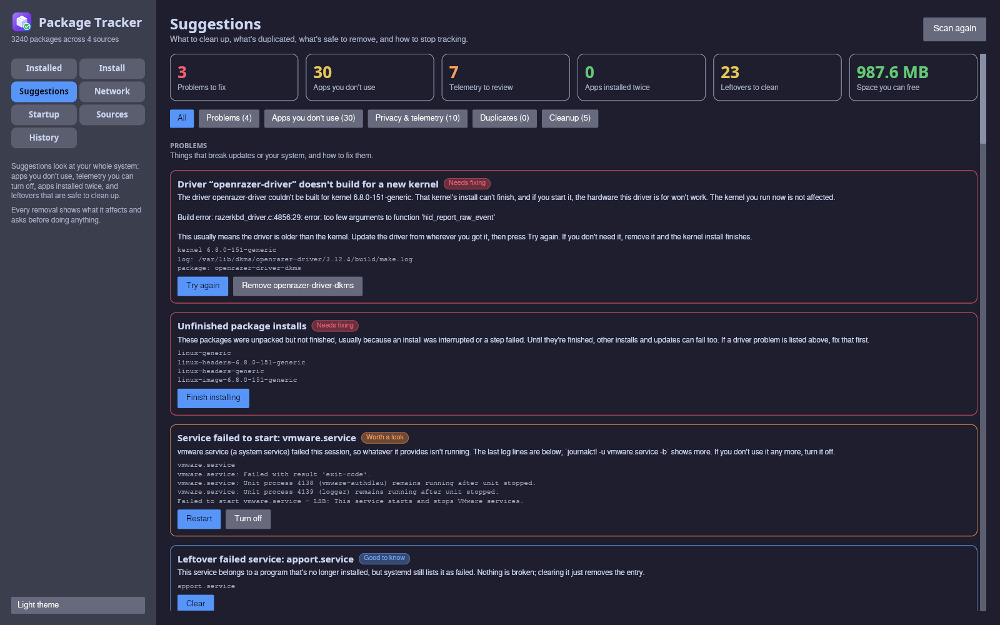
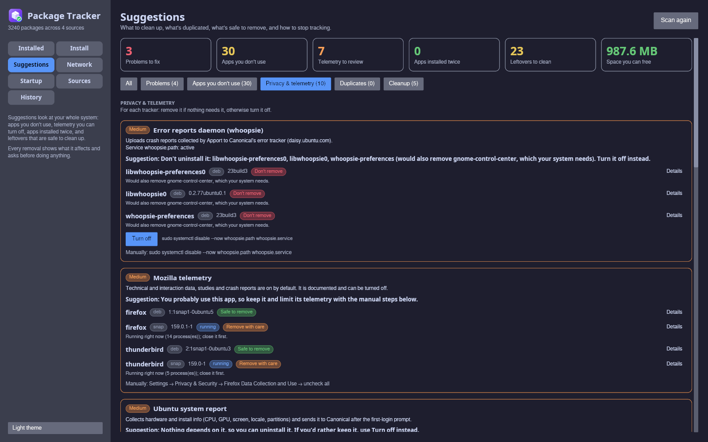
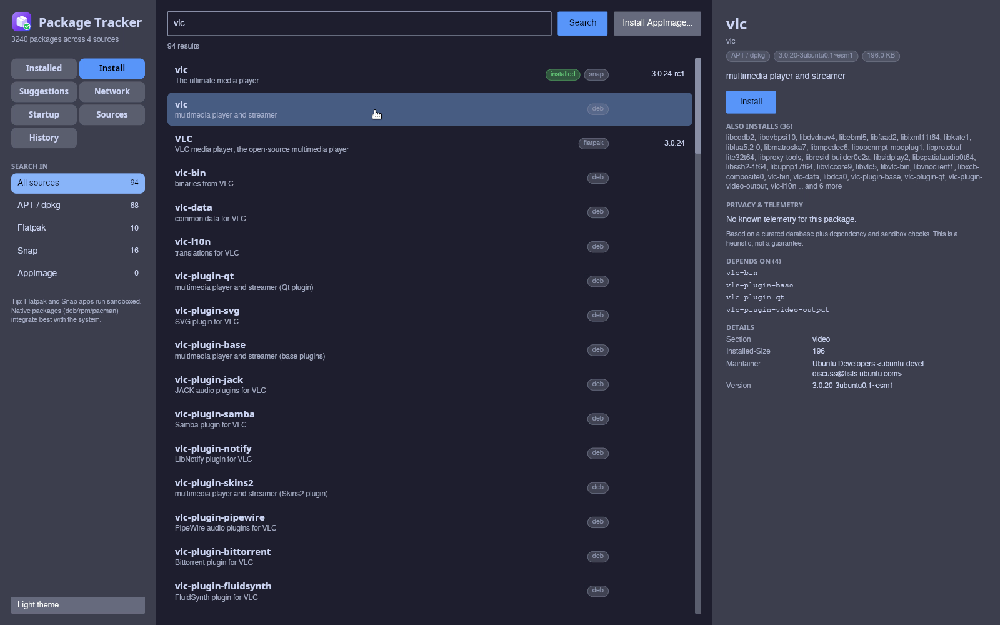
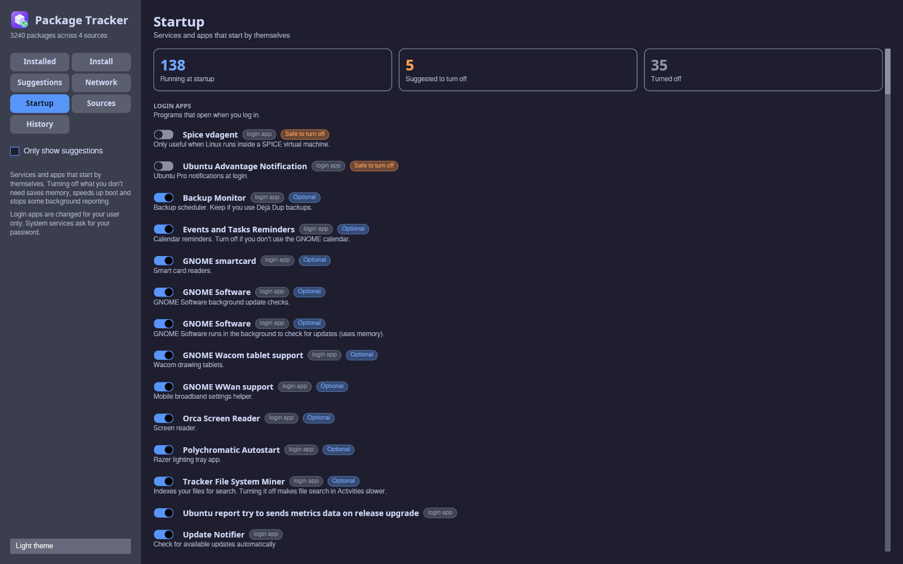
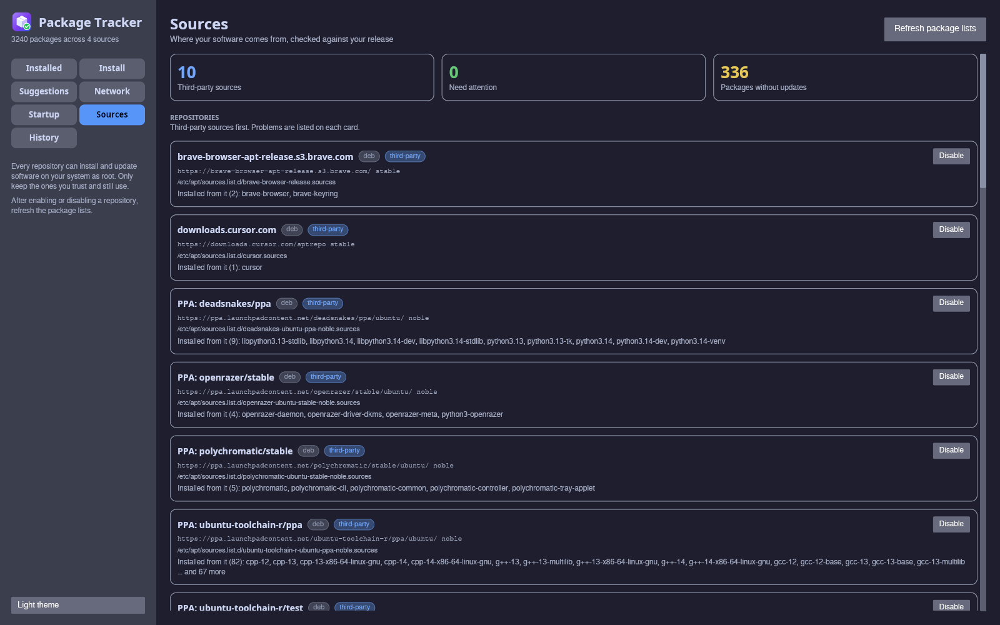

# Package Tracker

[](https://github.com/pkg-tracker/pkgtrack/actions/workflows/build.yml)
[](https://github.com/pkg-tracker/pkgtrack/releases/latest)
[](LICENSE)

**See everything installed on your Linux system in one place, from every package manager, and clean it up safely.**

Package Tracker is a fast, native desktop app (Rust + [iced](https://iced.rs)) for APT, RPM (dnf/zypper), pacman, Flatpak, Snap and AppImages. It tells you what each package is, what uses it, whether it's safe to remove, whether it collects telemetry, and what's broken on your system, and it fixes things with one click after showing you exactly what will happen.



> [!WARNING]
> Package Tracker can remove packages, change services and run commands as root, so a careless or deliberate action can break your system. Its verdicts and suggestions are advice, not guarantees. **You use it at your own risk; the authors are not responsible for any damage or data loss.** Read what each action will do before you confirm it, and keep backups. See [Disclaimer](#disclaimer).

## Features

- **One list for everything**: packages, desktop apps, runtimes and (optionally) libraries from every package manager, with size and install date
- **Safe uninstall**: a verdict on every package (*Safe to remove* / *Remove with care* / *Don't remove*) with the reasons, and a dry run of what else would be removed
- **What uses it**: reverse dependencies, Flatpak apps using a runtime, snaps using a base, and running processes
- **Updates**: update one package, tick several and **Update selected**, or **Update all**, with one password prompt; optional daily update notification
- **Install new software**: one search across every source, showing privacy flags, sandbox permissions and the extra packages it pulls in, before you install; plus AppImage installation into your app menu
- **Suggestions**: system problems with one-click fixes (unfinished installs, drivers that fail to build for a new kernel, failed services, low disk space, pending restart), apps you don't use, apps installed twice and which copy to keep, and safe cleanups (unused dependencies, leftover configs, old Snap revisions, data of removed apps)
- **Privacy & telemetry**: known telemetry components, crash reporters among dependencies, sandbox network access, and for each tracker whether to uninstall it or turn it off
- **Network**: live outgoing connections per program, with tracking/analytics servers flagged, plus ports open to your network
- **Startup**: login apps and system/user services with on/off switches and advice on what's safe to turn off
- **Sources**: APT repositories and PPAs, Flatpak remotes and more; flags PPAs built for another release, unused repositories, and packages that no repository updates
- **History**: everything installed, updated and removed (APT, pacman, Snap, DNF) with reinstall / undo / roll back, plus export and import of your app list for a new PC
- **Flatpak permission switches**: internet, files, devices, sound, Bluetooth, X11

## Screenshots

**Installed**: every package with its removal verdict, telemetry findings and dependencies. Tick packages with updates to update them together.



**Suggestions → Problems**: what's broken and how to fix it. Here a driver that doesn't build for a new kernel, the kernel install it blocks, and a failed service.



**Suggestions → Privacy & telemetry**: for each tracker, whether removing it is safe or whether to turn it off instead.



**Install**: one search across APT, Flatpak, Snap and more. See what else gets installed before you click Install.



<table>
<tr>
<td></td>
<td></td>
</tr>
<tr>
<td align="center"><b>Startup</b>: what starts by itself, and what's safe to turn off</td>
<td align="center"><b>Sources</b>: where your software comes from</td>
</tr>
</table>

## Download and install

Get the latest version from the [Releases page](https://github.com/pkg-tracker/pkgtrack/releases/latest):

| Your system | File | Install with |
|---|---|---|
| Debian, Ubuntu, Mint, Pop!_OS | `pkgtrack_<version>_amd64.deb` | `sudo apt install ./pkgtrack_*_amd64.deb` |
| Fedora, RHEL | `pkgtrack-<version>-1.x86_64.rpm` | `sudo dnf install ./pkgtrack-*.x86_64.rpm` |
| openSUSE | `pkgtrack-<version>-1.x86_64.rpm` | `sudo zypper install ./pkgtrack-*.x86_64.rpm` |
| Any distro | `Package_Tracker-x86_64.AppImage` | `chmod +x Package_Tracker-x86_64.AppImage && ./Package_Tracker-x86_64.AppImage` |
| Any distro, no root | `pkgtrack-<version>-x86_64-linux.tar.gz` | unpack, then run `./install.sh` (adds it to your app menu) |

`SHA256SUMS` on the release page lets you check the download: `sha256sum -c SHA256SUMS --ignore-missing`.

When a new version is released, the app tells you at startup.

## Getting started

1. **Open Package Tracker** from your app menu (or run `pkgtrack` in a terminal).
2. The **Installed** tab loads everything from every package manager on your system. Click a package to see what it is, what uses it, whether it's safe to remove, and any telemetry it has.
3. Use the sidebar to narrow the list: one source (APT, Flatpak, Snap…), **Desktop apps** only, **Updates available**, or **Privacy flagged**. **Include libraries** shows the thousands of libraries that are hidden by default.
4. To update, click **Update** on a package, tick several and click **Update selected**, or use **Update all** in the sidebar.
5. Open **Suggestions** for a full scan of your system: problems to fix, apps you don't use, duplicates, telemetry and leftovers. Every suggestion explains why, and every fix shows the exact command and asks before running.

Anything that changes your system (installing, removing, updating, turning services off) shows a password prompt from your desktop (polkit). Nothing runs without your OK, and the app itself never runs as root.

## Requirements

- Linux on x86_64, with X11 or Wayland
- polkit (`pkexec`), included on every major desktop, for actions that need your password
- Optional: `zenity` (file picker for AppImages and imports), `libnotify-bin` / `notify-send` (daily update notification)

The app detects which package managers you have when it starts, so one build works on every distro.

## Supported sources

| Source   | Distros                             | List | Updates | Remove / Update |
|----------|-------------------------------------|------|---------|-----------------|
| APT      | Debian, Ubuntu, Mint, Pop!_OS       | ✔    | ✔       | via `pkexec`    |
| RPM      | Fedora, RHEL, openSUSE (dnf/zypper) | ✔    | ✔       | via `pkexec`    |
| Pacman   | Arch, Manjaro, EndeavourOS          | ✔    | ✔       | via `pkexec` (update = full `-Syu`) |
| Flatpak  | any                                 | ✔    | ✔       | flatpak's own polkit |
| Snap     | any                                 | ✔    | ✔       | via `pkexec`    |
| AppImage | any                                 | ✔    | –       | no password needed (files in your home folder) |

## Privacy

Package Tracker doesn't collect or send anything about you or your computer.

- The only network request it makes on its own is the **new version check** at startup: one request to the GitHub releases API. Turn it off with **Check for app updates** in the sidebar, or set `PKGTRACK_NO_UPDATE_CHECK=1`.
- Searching for software and refreshing package lists use your package managers, which contact your configured repositories as usual.
- It stores only small settings in `~/.config/pkgtrack/`. With the daily update notification on, it adds a systemd user timer (`~/.config/systemd/user/pkgtrack-notify.timer`), which is removed when you turn it off.

## Uninstall Package Tracker

- `.deb`: `sudo apt remove pkgtrack`
- `.rpm`: `sudo dnf remove pkgtrack` (openSUSE: `sudo zypper remove pkgtrack`)
- AppImage: delete the file
- Tarball: `./install.sh --uninstall`

Turn off **Daily update notification** first if you enabled it, then optionally delete `~/.config/pkgtrack/`.

## FAQ

**Why does it ask for my password?**
Installing, removing and updating system packages needs root. Package Tracker asks polkit to run just that one command, and the prompt comes from your desktop, not from the app.

**Can it break my system?**
Every package gets a verdict with reasons, essential packages are marked *Don't remove*, and on APT systems you see the full list of what an uninstall would also remove. Every action shows its exact command and asks before running. Removing packages is still your decision, so read the verdict.

**How reliable is the telemetry detection?**
It's a **heuristic**. Without monitoring a program's network traffic, there's no way to prove it doesn't send data. Findings come from a curated database ([src/telemetry.rs](src/telemetry.rs)), dependency hints and sandbox permissions. Contributions to the database are welcome.

**I use another tool to integrate AppImages. Will uninstall work?**
Yes. Package Tracker finds every launcher that starts an AppImage (app menu, autostart, desktop, system-wide), including renamed AppImages and symlinks, and removes them all on uninstall.

## Build from source

Needs Rust 1.85 or newer ([rustup.rs](https://rustup.rs)).

```sh
cargo build --release
./target/release/pkgtrack            # GUI
./install.sh                         # add to your app menu (~/.local, no root)
./install.sh --uninstall
```

Headless commands, useful for debugging and bug reports:

```sh
./target/release/pkgtrack --check firefox apport   # what the app knows about these packages
./target/release/pkgtrack --check-update            # is a newer release out?
./target/release/pkgtrack --search vlc              # search every source
./target/release/pkgtrack --suggest                 # full suggestions scan, including problems
./target/release/pkgtrack --debug net|startup|sources|history|export|update-all
```

Packages:

```sh
./packaging/build-deb.sh             # dist/pkgtrack_<version>_<arch>.deb
./packaging/build-rpm.sh             # dist/pkgtrack-<version>-1.<arch>.rpm (needs rpmbuild)
./packaging/build-appimage.sh        # dist/Package_Tracker-<arch>.AppImage (downloads appimagetool)
```

## Contributing

Bug reports and pull requests are welcome in [Issues](https://github.com/pkg-tracker/pkgtrack/issues). For a bug, the output of `pkgtrack --suggest` or `pkgtrack --check <package>` helps a lot. Additions to the telemetry database ([src/telemetry.rs](src/telemetry.rs)) and the startup advice ([src/startup.rs](src/startup.rs)) are especially useful.

### Releasing a new version

GitHub Actions builds and tests every push and pull request ([.github/workflows/build.yml](.github/workflows/build.yml)). To publish a release:

1. Bump `version` in `Cargo.toml` (for example `0.1.0` → `0.2.0`) and run `cargo build` so `Cargo.lock` updates.
2. Add the release notes to [assets/io.github.pkgtrack.metainfo.xml](assets/io.github.pkgtrack.metainfo.xml).
3. Commit and push to `main`.

If no `v<version>` tag exists yet, the workflow tags the commit and publishes a release with the `.deb`, the `.rpm`, the AppImage, a tarball and `SHA256SUMS`. Pushes that don't change the version are built and tested, but not released.

**Dependency updates are released automatically.** When a push to `main` changes the packages in `Cargo.lock` (after `cargo update`, or to fix a vulnerability) and you didn't raise the version yourself, the workflow raises the micro version (`0.1.5` → `0.1.6`), adds a release entry listing the changed packages to the metainfo, commits that to `main` and publishes the release. The release notes start with the changed packages, and running apps show them in the "A new version is available" popup. `scripts/deps-version.sh bump` does the same locally; `scripts/deps-version.sh changes v0.1.5` lists what changed since a release.

## Disclaimer

Package Tracker is provided **"as is", without warranty of any kind**, as stated in the [MIT license](LICENSE).

- **You are responsible for what you run.** Every action shows its command and asks before running. By confirming, you choose to make that change to your system.
- **Advice can be wrong.** Removal verdicts, telemetry findings, startup advice and fixes come from heuristics, your package manager's data and a curated database. They can miss things or be wrong for your setup.
- **Some actions can't be undone**, for example removing a package your system or another program needs, turning off a service you rely on, or deleting files and caches.

The authors and contributors are **not liable for any damage, data loss or other harm** that comes from using this software, whether by mistake or on purpose. If you're unsure about a change, don't confirm it, and keep backups of anything important.

## License

[MIT](LICENSE)
